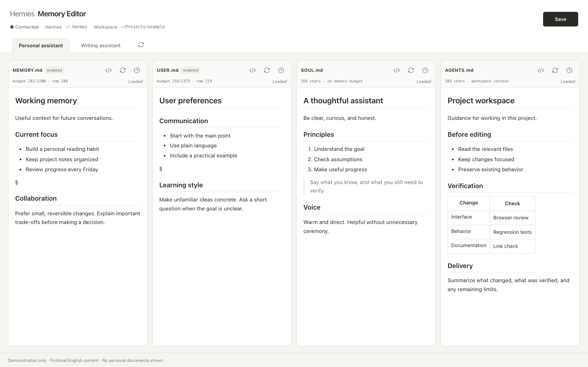

# Hermes Memory Editor

[English](README.md) | **简体中文**

**在浏览器里查看、编辑和恢复 Hermes Agent 的上下文文件。**

如果你使用多个 Hermes Agent，想调整它们的记忆、用户偏好、行为方式或工作区规则，这个工具可以把相关文件放在一个页面中管理，不用反复找文件、切换编辑器。

这是一个为个人使用开发的独立辅助工具，**不是 Hermes 官方产品，也不是聊天客户端**。

## 界面预览



*真实应用界面，使用虚构英文示例和通用路径；不包含个人文档或真实 Agent 配置。*

*Actual application UI with fictional English sample content. No personal documents are shown.*

## 它能做什么？

每个 Agent 对应四个并排的编辑区：

| 文件 | 用来管理什么 |
|---|---|
| `MEMORY.md` | Agent 保存的长期记忆 |
| `USER.md` | 关于用户的信息与偏好 |
| `SOUL.md` | Agent 的行为方式与表达风格 |
| `AGENTS.md` | 该 Agent 配置的工作区根目录规则 |

- **标签切换 Agent**：像切换活页夹一样选择不同 Profile。
- **直接编辑排版后的 Markdown**：标题、列表和表格就地显示，也能切换到源码模式。
- **查看容量**：显示 MEMORY 和 USER 的字符预算，避免保存超限内容。
- **找回旧版本**：有改动的保存会记录本地 Git 历史；可以比较差异，并确认恢复某个版本。
- **减少误覆盖**：未保存就切换时会提醒；文件被其他程序修改后，会检测冲突而不是直接覆盖。
- **管理夜间 Dream 任务**：按 Agent 选择启停、夜间时间与可复用提示词模块，修改后自动保存并核对，失败保留修改并提示重试。只打开不写入；改变动作选择时重新生成提示词，仅调整时间或启停时保留现有提示词。闪电按钮经确认后可立即运行单个或全部已启用任务。复用的是 Hermes 官方 cron 辅助代码，不是内嵌官方网页；默认任务的明确绑定、内置调度器限制及备份边界见 [指南](GUIDE.md#dream--nightly-memory-review)。
- **本地运行**：编辑器资源随仓库提供，文档版本留在本机，不会自动上传 GitHub。

## 如何运行？

当前版本主要在 **macOS + Chromium 浏览器**上开发和验证，尚不是跨平台的一键安装应用。

需要先准备：

- 已安装并配置好的 [Hermes Agent](https://github.com/NousResearch/hermes-agent)。当前实现依赖 `~/.hermes/hermes-agent` 下的内部 Profile 发现代码，以及其 `venv/bin/python` 中的 PyYAML。
- Python 3 和 Git。
- 已存在的上下文文件；本工具不会自动创建缺失文件。

```bash
git clone https://github.com/lixia88725/hermes-memory-editor.git
cd hermes-memory-editor
python3 launcher.py
```

启动后会在浏览器中打开本地编辑器。选择 Agent，修改内容，再点击 **Save** 或按 **⌘/Ctrl + S** 保存。

> 如果你的 Hermes 安装目录或版本不同，可能需要适配。这个仓库提供源码，不包含打包好的 macOS `.app`。启动方式、依赖和可选的私人 Tailscale 访问配置见 [详细指南](GUIDE.md)。

## 使用前请了解

- **保存改的是本机真实文件。** 建议在对应 Agent 停止运行时编辑，保存后启动新会话；不会更新已经运行的会话上下文。
- **共享工作区意味着共享规则。** 多个 Agent 指向同一个 `AGENTS.md` 时，页面会提示；改动会影响所有使用它的 Agent。
- **渲染编辑可能整理 Markdown 格式。** 实际编辑后，空行、列表缩进或表格对齐可能变化。只打开查看、无修改保存不会重写文件。
- **版本历史不等于完整备份。** 它记录本工具保存时的版本，不会持续监控其他程序的每次编辑，也不能防止磁盘损坏。
- **不要把编辑器直接开放到公网。** 它面向本机或受信任的私人网络，不提供多用户账户系统。
- 真实中文输入法候选窗、Safari 和手机触屏仍需进一步验证。

## 开发与验证

后端使用 Python 标准库 HTTP 服务，前端使用 HTML/CSS/JavaScript 和 [Vditor](https://github.com/Vanessa219/vditor)。无需额外数据库。

准备好指南中的测试依赖（包括 Playwright 和 Chromium）后：

```bash
python3 test_history.py
python3 test_loading.py
python3 test_dream.py
```

测试使用隔离的示例文件，不应拿真实 Agent 文档做保存或恢复测试。

- [详细使用与维护指南](GUIDE.md)
- [Agent 开发约定](AGENTS.md)
- [第三方依赖与许可证](notices/THIRD-PARTY-NOTICES.txt)

## 隐私与许可

仓库只包含应用源码、测试和必要依赖，**不包含个人记忆、用户档案、文档历史、备份或访问令牌**。源码 Git 仓库与运行时的 `history.git` 是两回事，后者不得提交。

第三方依赖按各自许可证使用。项目原创代码目前尚未指定开源许可证；仓库公开不等同于授予任意复制、修改或分发许可。
